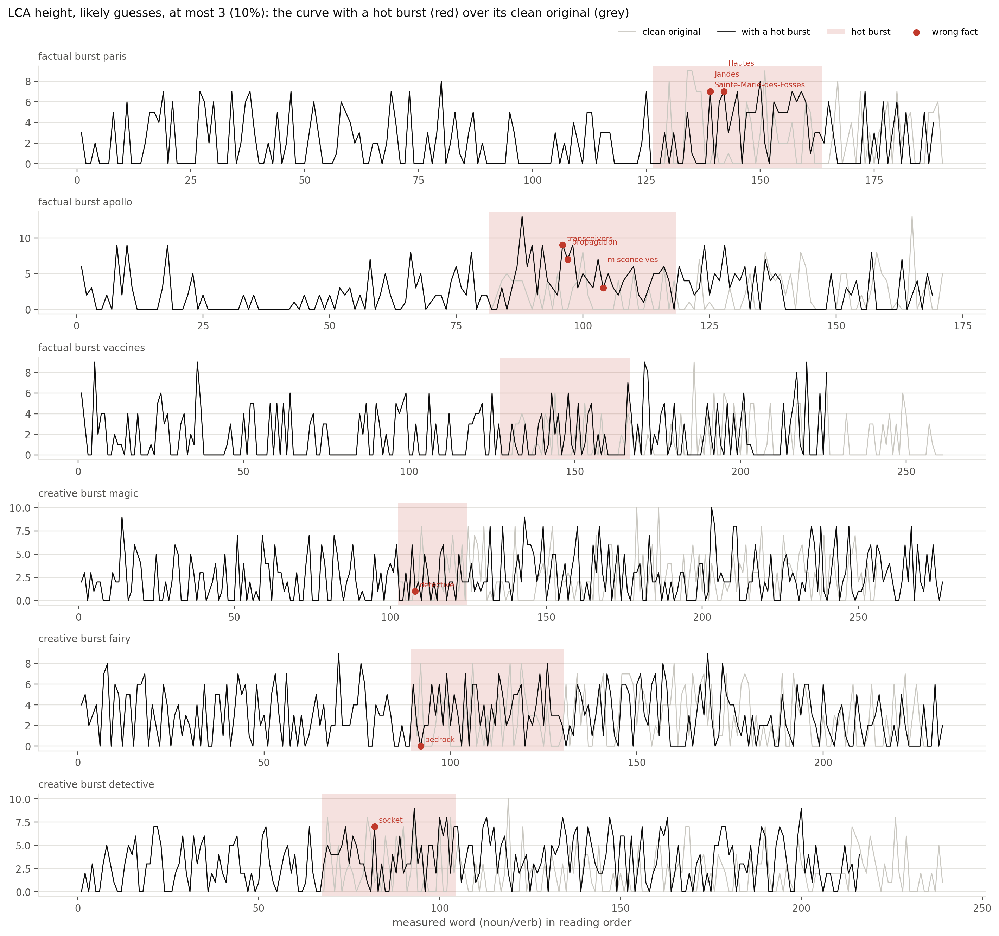
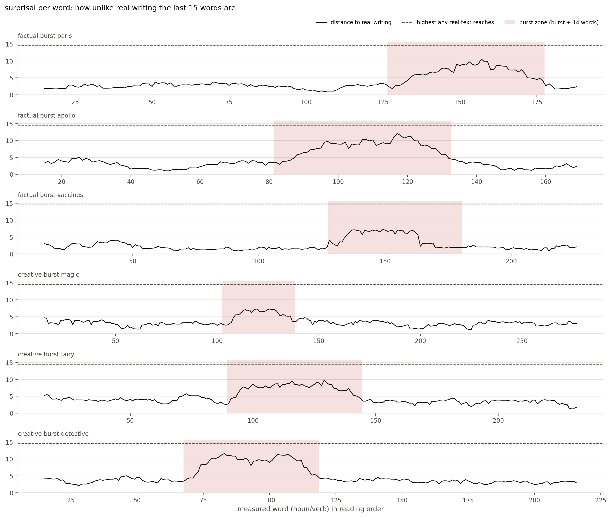
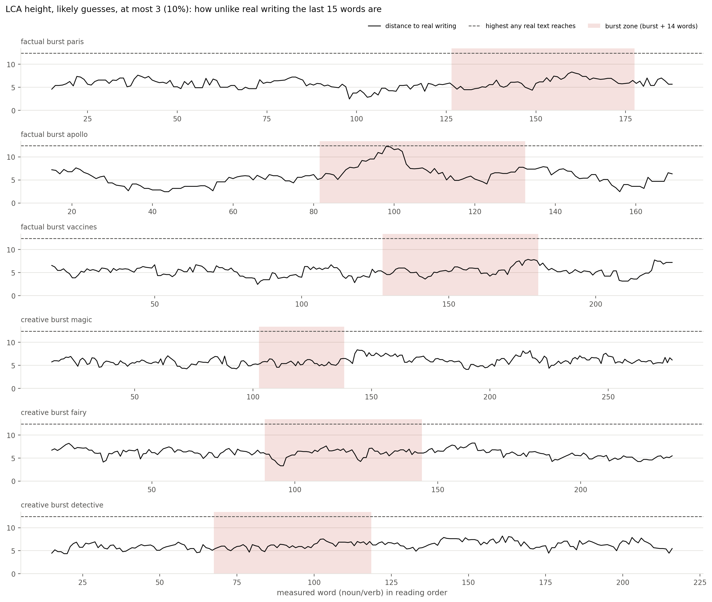
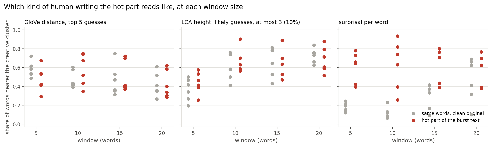
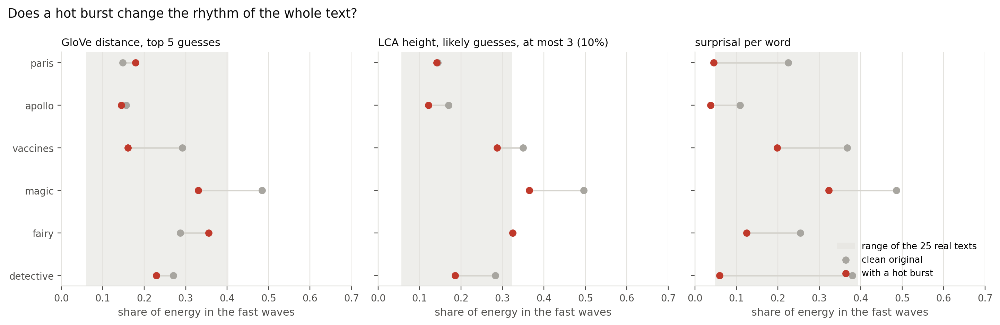
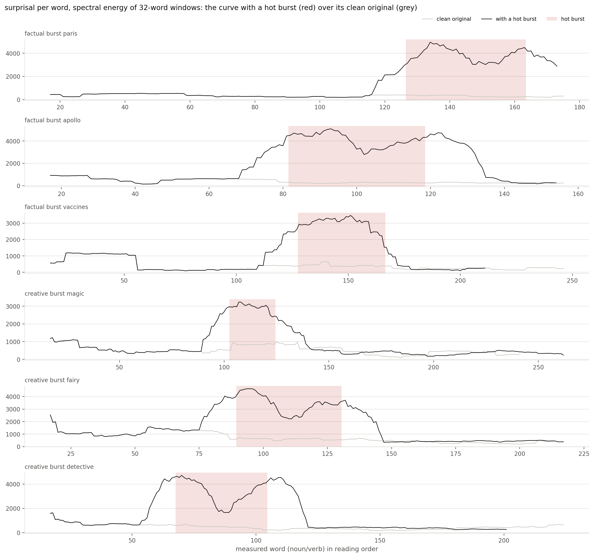

# Does one hallucination in a normal text show in how a language model reads it?

## 1. What was checked
Earlier work (notebooks 01–02) found two signals whose curves sort the 25 real texts by kind (factual vs creative):
**GloVe distance of the top 5 guesses** and **LCA height of the likely guesses, at most 3 (10%)**. Each puts 23 of
25 texts in the cluster of their own kind (`results/tables/clusters.csv`). A third signal is added here:
**surprisal per word**, how unexpected each real word was to Qwen.

The question here: take a normal text and make it hallucinate for a few sentences (wrong facts, a change of
subject) by raising the temperature of the model writing it. Does the text's curve move away from the normal text
there, and can the curve, followed word by word, point at the hallucination?

| texts | how many | made by |
|---|---|---|
| clean texts | 3 encyclopedia articles (Paris, Apollo 11, vaccines), 3 stories (magic school, fairy tale, detective) | Qwen2.5-7B-Instruct at temperature 0.7 |
| burst texts | one per clean text | the clean text, one hot stretch, then normal again |

Follow-ups from the 16/11 meeting (notebooks 04–05): a **classifier** learnt only from the 25 human texts, used on
Qwen's whole texts and on the pieces of each burst text at windows of 5–20 words; and the curves as **waves**
(Fourier): whole texts stretched to one length, then short windows to find where.

## 2. How the data was collected and calculated

### 2.1 The hot burst
A burst text is its clean original word for word up to a random point (25–75% of its tokens), then 120 tokens (a
few sentences) at temperature 3.0, then back to 0.7 until it is as long as the clean original. All parts keep only
tokens with at least 10% of the top token's probability (`min_p` = 0.1).

3.0 is the highest temperature at which the burst still reads as English. Cooler bursts hardly made anything up
(2.2 and 2.6: the correct text before the burst keeps the model on track); at 3.5 and above the burst turns into
word salad, at 5.0 into mixed scripts and code (all in `archive/burst_trials`).

What the bursts contain, read by hand (the marked words are in `texts_hallucinated/burst/marks.csv`):

| text | burst |
|---|---|
| Paris | invented places: streets "Sainte-Marie-des-Fosses and Jandes", Haussmann's "Hautes Citées" neighbourhoods |
| Apollo | invented instruments ("heat-activated-emission transceivers", a "low-gravity cross-channel propagation monitor"), then a muddle about heroes and school grades |
| Vaccines | correct |
| magic | Ella, the magic student, is called "the great detective" |
| fairy | the king's task changes from filling the wine cellar to laying bedrock across his lands |
| detective | a witness speaks "through his eye socket"; the paragraph stops making sense |

### 2.2 Reading
Qwen reads every clean and burst text exactly like the real texts (notebook 01): at each noun and verb it keeps its
top 5 guesses for the next word, and the probability it gave the word that really came. The three signals are
calculated at every such word, giving each text a curve:

| signal | at each noun/verb |
|---|---|
| GloVe distance, top 5 guesses | how far apart in meaning the model's 5 best guesses are (GloVe word vectors) |
| LCA height, likely guesses, at most 3 (10%) | how many WordNet levels the likely guesses climb before they share a category |
| surprisal per word | -log of the probability the model gave the real word's first token (high = unexpected) |

### 2.3 Distance to real writing
At every word, the last 15 words of the curve are compared with the most similar stretch of 15 words anywhere in
the 25 real texts (raw values, Euclidean distance), once against the factual cluster and once against the creative
cluster; the smaller is the **distance to real writing**. Low means "these words read like real writing".

The **normal ceiling** is the highest distance any real text reaches when it is compared without itself
(GloVe 0.617, LCA 12.41, surprisal 14.54).

Because the distance looks back 15 words, a burst can show from its first word until 15 words after it: the
**burst zone**. It covers 16–36% of a text's words (about a quarter).

### 2.4 The classifier (notebook 04)
**1-NN with DTW**: a curve gets the kind of the single human text whose curve is closest (the DTW of notebook 02).
It learns only from the 25 human texts; Qwen's texts are only labelled. It is scored by **leave-one-out**: each
human text labelled from the other 24. A piece of a burst text (before, hot part, after) is too short to compare
whole, so it is labelled word by word: are the last `window` words closer to the factual cluster's writing or the
creative cluster's (the distance of 2.3)? The share of words nearer the creative cluster is compared with the same
words of the clean original.

### 2.5 Curves as waves (notebook 05)
A curve is rewritten as a sum of waves; its **spectrum** says how much of each speed it holds, from slow (long
trends) to fast (word-to-word jitter). Every curve is stretched to 256 points so spectra line up; the 0-speed term
(the sum of the values) is left out. The **fast share** is the part of the energy in the faster half of the speeds.
Classifiers on rhythm: 1-NN on spectra, and **BOSSVS** and **WEASEL** (`pyts`, fixed settings), which turn short
windows of the curve into Fourier "words" and learn which words each kind uses. To find *where*, the spectral
energy of 16- and 32-word windows along the text (by Parseval's theorem: how much the curve swings in the window).

## 3. Results

### The curves


One row per text: the burst text's raw curve (black) over its clean original's (grey; the same up to the burst),
the burst shaded red, a red dot on each marked word. The same figure for GloVe is
`results/burst/figures/bursts_glove_top5.png`.

Most invented names are not measured themselves (the reader measures nouns and verbs it can tag, and skips words
that do not start on a token boundary), so a mark sits on the next measured word. Where that word ranks among its
text's values (1 = highest):

| text | marked word | lands on | GloVe rank | LCA rank |
|---|---|---|---|---|
| Paris (188 words) | Sainte-Marie-des-Fosses, Jandes | accolades | 18 | 3 |
| | Hautes | neighborhoods | 72 | 3 |
| Apollo (169 words) | transceivers | cross | 37 | 2 |
| | propagation | propagation | 124 | 14 |
| | misconceives | misconceives | 169 | 54 |
| magic (277) | detective | known | 177 | 168 |
| fairy (232) | bedrock | bedrock | 37 | 173 |
| detective (216) | socket | socket | 24 | 9 |

### Distance to real writing


Surprisal: in every text the distance rises as the burst starts, stays high through it and falls back about 15
words after it ends. Nowhere else in any text does it come close. It stays below the dashed line, though: some
human texts are more surprising to Qwen than these bursts.



One line per text: how unlike real writing its last 15 words are, the dashed line the most any real text reaches,
the burst zone shaded. Apollo climbs to the dashed line inside its burst zone; Paris rises a little late in its
zone; the other four stay flat. The GloVe version (`distance_glove_top5.png`) is flat everywhere.

Per text and signal (`results/burst/tables/burst_vs_clean.csv`): the highest distance in the burst zone, anywhere
else in the burst text, and anywhere in the clean original. Normal ceiling: GloVe 0.617, LCA 12.41, surprisal 14.54.

| text | burst | surprisal: zone / elsewhere / clean | GloVe: zone / elsewhere / clean | LCA: zone / elsewhere / clean |
|---|---|---|---|---|
| Paris | invented places | **10.55** / 3.79 / 3.82 | 0.276 / 0.294 / 0.294 | **8.31** / 7.62 / 9.11 |
| Apollo | invented instruments, then a muddle | **12.07** / 5.07 / 5.07 | 0.280 / 0.292 / 0.334 | **12.29** / 7.87 / 8.31 |
| Vaccines | correct | **7.33** / 4.06 / 4.07 | 0.327 / 0.333 / 0.320 | **7.87** / 7.75 / 7.21 |
| magic | one slip | **7.27** / 4.68 / 4.71 | 0.388 / 0.414 / 0.482 | 6.48 / 8.37 / 8.94 |
| fairy | the task changes | **9.77** / 5.73 / 5.73 | 0.317 / 0.378 / 0.378 | 7.62 / 8.25 / 8.19 |
| detective | stops making sense | **11.61** / 5.03 / 5.04 | 0.279 / 0.421 / 0.365 | 7.55 / 8.19 / 8.06 |

Bold: the text's highest distance is in its burst zone. The zone covers 14–33% of a text's words, so by chance
about 1.5 of 6 texts per signal would have their peak there.

### The classifier (notebook 04)
Each human text labelled from the other 24 (`results/classify/tables/leave_one_out.csv`): best 22 of 25 (GloVe
top 1, surprisal per word, GloVe likely 5%); surprisal 22, LCA 20, GloVe top 5 20.

Qwen's whole texts, labelled with the kind they were written as (of 6):

| signal | clean texts | burst texts |
|---|---|---|
| GloVe top 5 | 4 | 3 |
| LCA likely top 3 (10%) | 1 | 1 |
| surprisal | 3 (all called creative) | 3 |



Share of words nearer the creative cluster: the hot part of each burst text (red) and the same words of its clean
original (grey). On surprisal with a 10-word window every hot part is above every clean original (0.26–0.93
against 0.06–0.23) and above its own text before the burst (0.19–0.28); at 15–20 words the two overlap. GloVe and
LCA do not separate them at any window.

### Rhythm (notebook 05)
Each human text labelled from the other 24 (`results/fourier/tables/human_texts.csv`), best signal per method:
BOSSVS 23 of 25 (LCA top 3), 1-NN on spectra 21, spectra clustered 21, WEASEL 15; 1-NN DTW 22. On Qwen's clean
texts BOSSVS gives the written kind 5 of 6 times on LCA (DTW: 1 of 6), 1 on GloVe, 3 on surprisal.



The surprisal fast share drops in all 6 burst texts (Paris 0.23 → 0.05, detective 0.38 → 0.06); LCA in 5 of 6,
by less; GloVe in 4 of 6, in both directions.



Spectral energy of 32-word windows of the surprisal curve: the highest window is inside the burst in 6 of 6 texts
(16 words: 5 of 6), 1.8 to 9 times the clean original's highest. On LCA and GloVe: at most 1 of 6.

## 4. What we can gather
1. **A hotter burst invents more, but only up to a point.** At 3.0 the factual bursts make up places and
   instruments; above 3.0 they stop making sense instead of getting more wrong. Vaccines stayed correct at every
   temperature that stays readable.
2. **Surprisal finds every burst, but not wrong facts.** In all 6 texts the highest surprisal distance is in the
   burst zone, 1.5 to 2.8 times anything the clean original reaches. But the correct Vaccines burst and the story
   bursts rise as clearly as the invented Paris and Apollo facts. The burst was sampled from Qwen itself at 3.0,
   so its words are, by construction, ones Qwen found unlikely: surprisal sees *hot writing*, true or not. It also
   needs the text's own earlier words as the baseline, since some human texts are more surprising still (ceiling
   14.54).
3. **LCA reacts to the factual bursts, but clearly only in Apollo; GloVe to none.** Apollo comes close to anything
   real writing reaches (12.29 against 12.41), far above its clean original (8.31). Paris and Vaccines peak in their
   zone, but Paris stays below its clean original (8.31 against 9.11) and Vaccines is barely above it (7.87 against
   7.21). None of the 3 stories peak in their zone. GloVe has its peak in the burst zone in none of the 6 texts.
4. **Around invented facts, the model's guesses scatter.** The words right after the invented Paris streets and
   the invented Apollo instruments are among the 3 highest LCA values of their text: the model expects something
   but cannot say what kind of thing (after "propagation": detector, antenna, communication, device, radar).
5. **Not a hallucination detector yet.** Surprisal says *where* the writing went off, LCA hints *whether* facts
   were invented, but only Apollo shows both clearly. Single LCA spikes as high as Apollo's also appear in clean
   text (the clean Apollo reaches 13 at word ~165); what stands out is a stretch that *stays* high. Slips inside
   stories show on surprisal only, like any other hot stretch.
6. **A classifier learnt from human writing works on human writing, not on Qwen's.** 22 of 25 human texts get
   their own kind with 1-NN DTW, 23 with BOSSVS on LCA; but Qwen's clean texts get the kind they were written as
   barely more often than by chance (DTW), except BOSSVS on LCA (5 of 6). Qwen does not write like the human texts
   of the same kind, so whole-text labels say little about whether a Qwen text hallucinates.
7. **What locates a burst is a change against the text's own earlier words, on surprisal.** Word by word, the hot
   part reads like human creative writing (10-word windows), unlike the same words of the clean text. Over the
   whole text, the burst lowers the fast share in all 6 texts (it adds one long rise and fall), and 32-word windows
   then find it in 6 of 6. The window-energy step is close to a moving spread of the curve (Parseval).

Caveats: 6 texts with one burst each (one seed), and only the two factual bursts with invented facts carry the
LCA result; the reference writing is human, the burst texts are Qwen's.

Next to try: use surprisal to find the stretch and LCA within it to judge it; several bursts per text (more seeds), to see whether LCA rising in factual bursts holds up; a rule
that looks for LCA staying high over several words rather than one peak; comparing each text with clean texts
written by the same model rather than with human writing.

## 5. How it was executed in code
| file | what it does |
|---|---|
| `config/qwen_config.py` | prompts, `COOL_TEMPERATURE`, `BURST_TEMPERATURE`, `BURST_TOKENS`, `BURST_RANGE`, `MIN_P`, `EVOLVING_SIGNALS`, `EVOLVING_WINDOW`, folders |
| `analysis/generate.py` | `write_story` (one text at one temperature), `burst_story` (clean text, hot burst, cool again) |
| `analysis/signals.py` | the signals and each text's curve (shared with notebook 02) |
| `analysis/cluster.py` | DTW + k-medoids into the factual and creative clusters (shared with notebook 02) |
| `analysis/evolving.py` | `distance_to_writing`, `evolving_profile`, `normal_ceiling`, `first_row_from_char` |
| `analysis/figures.py` | `plot_bursts_stacked` (raw curves, burst shaded, wrong words dotted) and `plot_distance_stacked` (distance to real writing, ceiling, burst zone); one row per text |
| `01_run_model.ipynb` | Qwen reads the 25 real texts |
| `02_results.ipynb` | clusters the real texts; picks the two signals |
| `03_hallucination_burst.ipynb` | writes and reads the clean and burst texts, the stacked curve and distance figures, the distance table, the answer |
| `analysis/classify.py` | `dtw_to_references`, `nearest_neighbour`, `leave_one_out`, `cluster_kinds`, `nearer_centre`, `nearer_cluster_per_word`, `share_creative` |
| `analysis/fourier.py` | `stretch`, `spectrum`, `fast_share`, `window_energy`, `bossvs_leave_one_out`, `weasel_leave_one_out`, `bossvs_labels` |
| `04_classify.ipynb` | 1-NN DTW leave-one-out on the human texts; Qwen's whole texts; the burst pieces at windows 5–20 |
| `05_fourier.ipynb` | spectra: clustering and 3 classifiers on the human texts; the fast share of Qwen's texts; where, with windows |
| `tests/` | 33 tests for generate, evolving, classify, fourier and figures |

```python
# analysis/generate.py: one hot stretch inside a clean text
hot_ids = write_story(model, tokenizer, prompt, hot_temperature, seed=seed + 2000,
                      story_start_ids=cool_ids[:burst_start], max_new_tokens=burst_tokens, kind=kind, min_p=min_p)
story_ids = write_story(model, tokenizer, prompt, cool_temperature, seed=seed + 3000, story_start_ids=hot_ids,
                        max_new_tokens=max(len(cool_ids) - len(hot_ids), 1), kind=kind, min_p=min_p)
```

The earlier factual-vs-creative write-up and the planted and temperature experiments (the old notebooks 03–06) are in
`archive/hallucination_planted_and_temperature/`.
