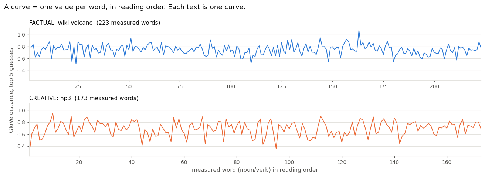
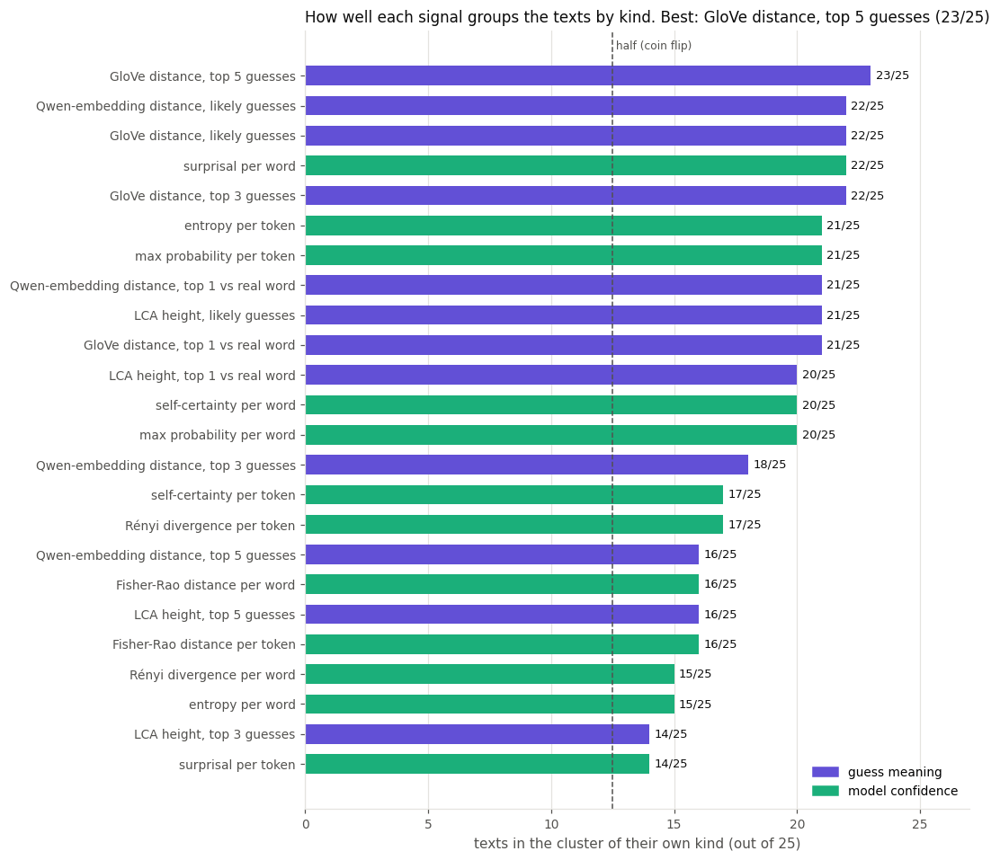
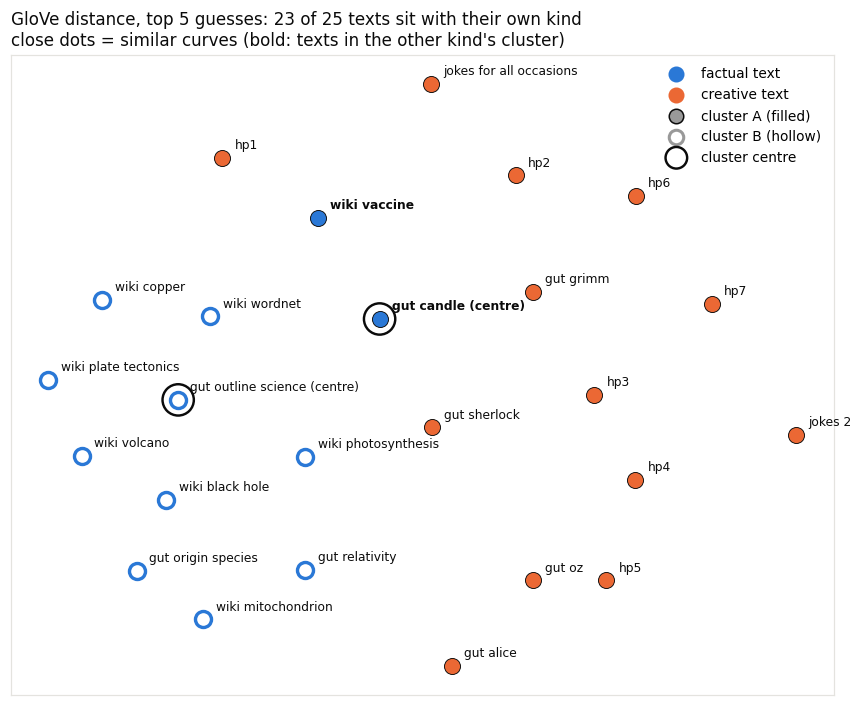
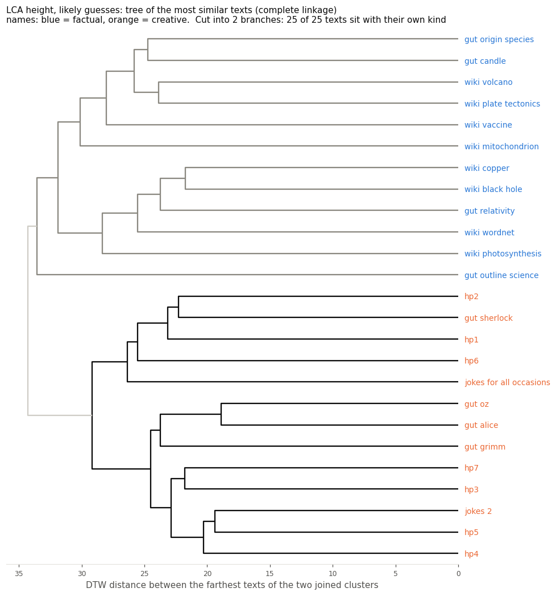
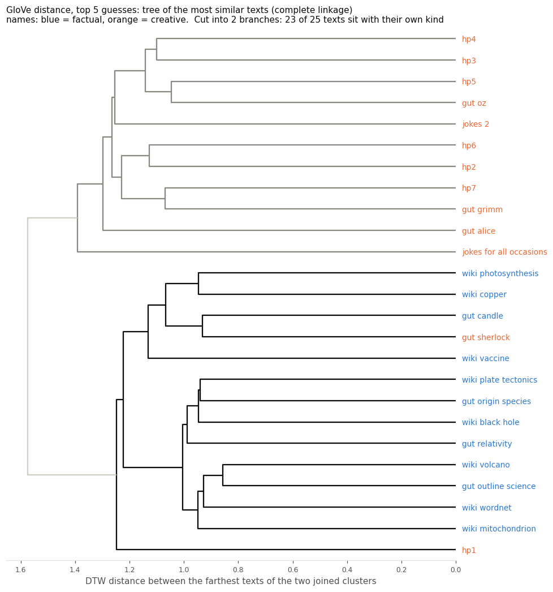

# Can a language model tell factual from creative text by how it reads?

## 1. What was checked

**Hypothesis:** as Qwen2.5-7B-Instruct reads a text word by word, texts of the same kind (factual or creative) produce similar patterns over time. So a clustering algorithm that only sees those patterns, not the labels, should put factual texts with factual texts and creative with creative.

**Data:** 25 English excerpts of 520–700 words each.

| kind | texts |
|---|---|
| factual (12) | 8 Wikipedia articles (black hole, copper, mitochondrion, photosynthesis, plate tectonics, vaccine, volcano, WordNet); 4 classic science books from Project Gutenberg (Faraday's *Chemical History of a Candle*, Darwin's *Origin of Species*, Thomson's *Outline of Science*, Einstein's *Relativity*) |
| creative (13) | one excerpt from each of the 7 Harry Potter books; *Alice in Wonderland*, *Grimm's Fairy Tales*, *The Wizard of Oz*, *Sherlock Holmes*; 2 joke books |

---

## 2. How the data was collected and calculated

### 2.1 The model reads each text
The model reads each text once (4-bit weights on an 8 GB GPU). At every token it gives a probability for every possible next token, using only the text *before* that token. So it never sees the word it is predicting.
### 2.2 Where values are taken
- **Per word:** at every noun and verb of the text (about 195 per text). The model's **5 best guesses** there are its most likely next words of the same part of speech, reduced to dictionary form.
- **Per token:** at every token of the text (about 895 per text).

Example, *Alice*, at "sat": the guesses are `sit, walk, march, jump, dance`.

### 2.3 The 24 signals

**12 guess-meaning signals: how different are the model's guesses?** One of three measures, applied to one of four guess sets.

| measure | how a set of words is scored |
|---|---|
| GloVe distance | average cosine distance between the words' GloVe vectors (1 − cosine similarity; 0 = same meaning) |
| Qwen-embedding distance | the same, using Qwen's own word vectors |
| LCA height | WordNet levels climbed until the words share a category (dog, cat → 2) |

| guess set | words scored |
|---|---|
| top 5 / top 3 | the 5 / 3 best guesses |
| likely guesses | guesses with at least 10% of the #1 guess's probability (0 if only one) |
| top 1 vs real word | the #1 guess and the word that really came |

**12 model-confidence signals: how sure was the model?** Six values from LM-Polygraph, each taken per word and per token. *p* is the model's next-token probability distribution.

| value | formula |
|---|---|
| surprisal | −ln *p*(real token) |
| max probability | largest *p* |
| entropy | −Σ *p* ln *p* |
| self-certainty | mean(ln *p*) + ln V |
| Rényi divergence | divergence (α = 0.5) of *p* at temperature 2 from uniform |
| Fisher-Rao distance | distance of *p* at temperature 2 from uniform |

### 2.4 A text becomes a curve
For each signal, a text's **curve** is its raw values in reading order: one point per word (or token). Nothing is averaged, smoothed or rescaled.



### 2.5 Grouping the texts
- **Distance between two texts: DTW** (dynamic time warping) between their raw curves. The curves are lined up point by point, each point may shift by up to 10% of the curve length, and the distance is √(sum of squared gaps) along the best alignment. Texts of different lengths can be compared this way.
- **Clustering: k-medoids, 2 clusters.** It tries every pair of texts as the two cluster centres, gives each text to its nearer centre, and keeps the pair with the smallest total distance. Each centre is a real text, not an averaged curve.
- **Score:** a text is **in the right cluster** if most texts in its cluster are of its own kind.
- **Text map:** each text drawn as a dot, placed so that distances on the map match the DTW distances as closely as possible (multidimensional scaling). The map is only a picture; the clustering uses the DTW distances directly.
- **Hierarchical clustering (second method, same DTW distances):** every text starts alone, and the two clusters whose *farthest* pair of texts is closest are joined next (complete linkage, so nothing is averaged). The result is a tree (dendrogram). Cutting it into its last two branches gives a second 2-cluster answer, scored the same way.

---

## 3. Results





| | k-medoids | tree cut in two |
|---|---|---|
| **GloVe distance, top 5 guesses** | **23/25**: factual 10/12, creative 13/13 | 23/25 |
| GloVe distance, top 3 guesses | 22/25: factual 12/12, creative 10/13 | 22/25 |
| GloVe distance, likely guesses | 22/25: factual 9/12, creative 13/13 | 20/25 |
| Qwen-embedding distance, likely guesses | 22/25: factual 9/12, creative 13/13 | 20/25 |
| surprisal per word | 22/25: factual 11/12, creative 11/13 | 13/25 |
| **LCA height, likely guesses** | 21/25: factual 8/12, creative 13/13 | **25/25** |
| entropy per word | 15/25 | 21/25 |
| median of the 12 guess-meaning signals | 21/25 | |
| median of the 12 model-confidence signals | 17/25 | |
| worst (LCA height top 3, surprisal per token) | 14/25 | 14/25, 13/25 |





Read a tree from right to left. Texts that join early (near 0) have similar curves; the further left two branches join, the more different they are. Names are coloured by real kind. Trees for the 10 best signals: `results/figures/4_tree_01_*.png` … `4_tree_10_*.png`.

All 24 signals, with the misplaced texts: `results/tables/clusters.csv`. Text maps for the 10 signals scoring 21/25 or more: `results/figures/3_map_01_*.png` … `3_map_10_*.png`.

A black ring marks each cluster's centre text (its medoid), and the two centres of each signal are listed in `clusters.csv`. For GloVe top 5, the creative cluster's centre is Faraday's *Candle*, a factual text: the most typical member of that cluster is a factual text written like a story.

On a map, a dot's fill shows its real cluster, which is decided by the DTW distances. Its position only approximates those distances in 2D (for GloVe top 3, map distances correlate 0.72 with the real ones). So a dot can be drawn near the other cluster: *hp1* sits among the factual texts on the GloVe top-3 map but is closer to the creative centre.

---

## 4. What we can gather

1. **The hypothesis holds for the best signal.** Using only the GloVe-distance curves of the model's top 5 guesses, clustering puts 23 of 25 texts with their own kind. That includes all 13 creative texts.
2. **What separates them is the *meaning* of the model's guesses, more than its confidence.** The three best signals are all GloVe guess distances. Guess-meaning signals reach a median of 21/25, confidence signals 17/25.
3. **In creative texts, the guesses often agree in meaning; in factual texts they rarely do.** The creative curve keeps dipping, where the model's 5 guesses are close in meaning (`sit, walk, march, jump, dance`). The factual curve stays high. In other words, the model often knows *what kind* of word comes next in a story, but not in an encyclopedia.
4. **Creative texts form one tight group; factual texts are the harder side.** 13 of the 24 signals put at least 12 of the 13 creative texts together, but only 3 signals keep 11 or more of the 12 factual texts together.
5. **The misplaced texts point to writing style.** The old Gutenberg science books are put with the creative texts most often:
   - Faraday's *Candle*: in 19 of the 24 signals
   - *Outline of Science*: 16 of 24
   - *Origin of Species*: 13 of 24

   These are explanatory, story-like prose. Wikipedia articles almost never are: *vaccine* and *mitochondrion* 2 of 24 each, with *WordNet* (14) the exception. *Alice* is the creative text misplaced most often (10 of 24), and every one of those is a confidence signal: the model finds it unusually predictable.

6. **The tree gives the cleanest split of all, with one signal.** With LCA height on the likely guesses, the tree's two branches are exactly the 12 factual and the 13 creative texts (25/25), where k-medoids gets 21/25. With GloVe top 5, both methods score 23/25 but misplace different texts. k-medoids puts *Candle* and *vaccine* with the creative texts. The tree keeps them with the factual texts but puts *Sherlock* and *hp1* there too. Texts at the border change sides depending on the method. Surprisal per word drops to 13/25 because its tree splits off a small group of 4 texts first. So it groups texts in pairs well, but has no clean two-way split.

**Caveats**
- 25 texts is a small sample; one text is 4% of the score.
- The two kinds also differ in source and style: encyclopedia vs. fiction and jokes. Part of what is detected may be *how* a text is written, not whether it is factual.

---

## 5. How it was executed in code

| step | file | what it does |
|---|---|---|
| settings | `qwen_config.py` | model, folders, number of guesses, DTW window |
| run the model | `01_run_model.ipynb` → `lca_core.LCAMeter.run` | reads every text once and saves, per text, `results/run/words/<text>.csv` (one row per noun/verb: guesses, their probabilities, confidence values) and `results/run/tokens/<text>.csv` (one row per token: confidence values) |
| build signals | `analysis/signals.py` | the 24 signals; turns a text's table into its curve |
| cluster | `analysis/cluster.py` | DTW distances, k-medoids, hierarchical tree, score, text map |
| figures | `analysis/figures.py` | example curves, all-signals chart, text maps (2D and 3D), trees |
| results | `02_results.ipynb` | runs signals → clustering → figures; writes `results/tables/clusters.csv` and `results/figures/` |

The snippets below are condensed from the files named; the files have the full versions.

**A guess-meaning value** at one noun/verb (`analysis/signals.py`, `lca_core.py`):

```python
guesses = word_row["candidates"].split()                 # the model's 5 best guesses, best first
glove_mean, _glove_max = glove_spread(guesses[:5])        # average cosine distance over every pair

def glove_spread(words):                                  # lca_core.py
    rows = _glove_rows(words)                             # each word's row in the GloVe table
    vectors = []
    for row in rows:
        vectors.append(E[row])
    return _pairwise_spread(vectors)                      # mean (and max) of 1 - cosine similarity
```

**A confidence value** at one token (`lca_core.LCAMeter._token_stats`):

```python
stats["surprisal"] = -log_probs[rows, true_ids]           # -ln p(real token)
stats["entropy"] = -(probs * log_probs).sum(dim=-1)       # -sum p ln p
```

**Clustering one signal** (`analysis/cluster.py`):

```python
def cluster(curves):
    table = cdist_dtw(to_time_series_dataset(curves), global_constraint="sakoe_chiba",
                      sakoe_chiba_radius=dtw_radius(curves))      # DTW distance between every pair of raw curves
    labels, centres = k_medoids(table)
    return labels, centres, table

def k_medoids(table):
    best_cost = None
    for centre_a, centre_b in combinations(range(len(table)), 2):  # every pair of texts as the two centres
        nearer_to_b = table[:, centre_b] < table[:, centre_a]
        cost = np.where(nearer_to_b, table[:, centre_b], table[:, centre_a]).sum()
        if best_cost is None or cost < best_cost:
            best_cost = cost
            best_labels = nearer_to_b.astype(int)
            best_centres = [centre_a, centre_b]                    # the two centre texts
    return best_labels, best_centres
```

**The score** (`analysis/cluster.py`):

```python
for cluster_label in set(labels):
    members = labels == cluster_label
    majority_kind = pd.Series(kinds[members]).mode()[0]        # the cluster is named after its most common kind
    correct[members] = kinds[members] == majority_kind
```

To rerun: `01_run_model.ipynb` (only needed for new texts), then `02_results.ipynb`. Earlier analyses are kept in `archive/`.
